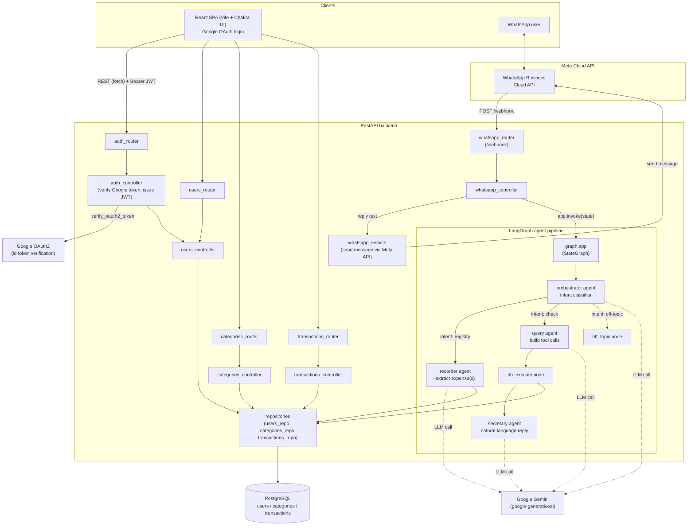
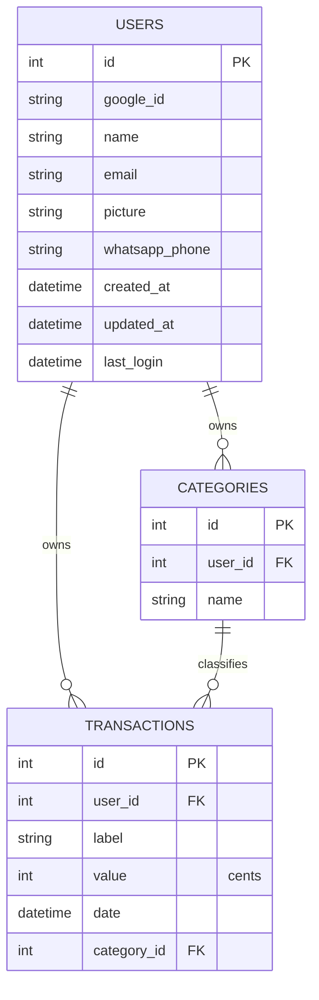
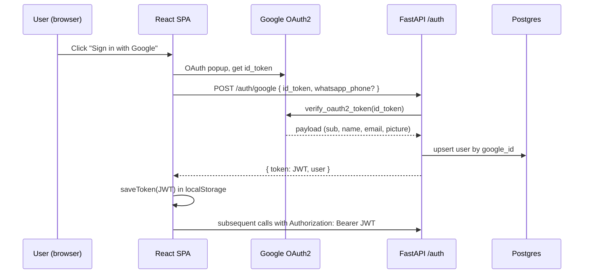
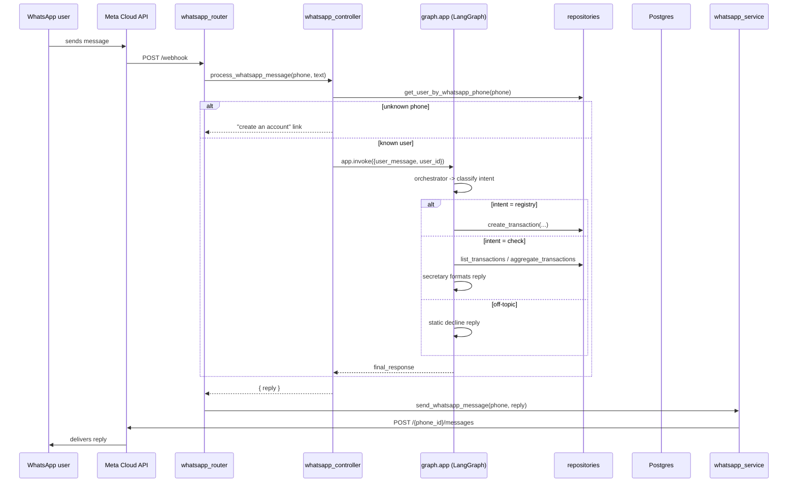

# Money Budget — System Design

## 1. Overview

Money Budget is a personal finance tracker with two front doors onto the same
data: a **React web dashboard** and a **WhatsApp chatbot**. Both are backed by
a single FastAPI service and a Postgres database. The WhatsApp side runs
messages through a small **LangGraph agent pipeline** that classifies intent,
extracts expenses from free text, or answers questions by querying the
database and summarizing the results in natural language.

## 2. High-level architecture

## 3. Components

### 3.1 Front-end (`front-end/`)
- React (Vite) SPA, `HashRouter`-based, Chakra UI for components/theming.
- `lib/auth.js` stores the JWT in `localStorage` and attaches it as a Bearer
  token to every API call (`lib/utils.js` / `api/endpoints.js`).
- Pages: `dashboard` (balance + charts), `report-expense` (manual entry),
  `transactions-display` (table of history, delete from a row menu, and a side
  panel to add a transaction via `POST /transactions/create`), `investments`, `account`.
- `components/Chatbot.jsx` gives the same conversational flow as WhatsApp
  from inside the web app.

### 3.2 Backend (`back-end/`)
Layered FastAPI app: **router -> controller -> repository -> DB**.
- `routers/` — HTTP route declarations only.
- `controllers/` — request orchestration / business rules.
- `repositories/` — SQLAlchemy queries against the Postgres tables. Every
  function takes the database session as its first argument.
- `services/whatsapp_service.py` — outbound calls to the Meta Cloud API.
- `db/connection.py` — SQLAlchemy engine/session (`DB_URL`, defaults to a
  local SQLite file for dev). Each request gets its own session from the
  `get_db` dependency, closed when the request ends. Code outside a request
  (the LangGraph nodes) opens a short-lived one with `session_scope()`.

### 3.3 Auth
- Frontend obtains a Google ID token (`@react-oauth/google`).
- `POST /auth/google` verifies it against Google, upserts the user, and
  returns an app-issued JWT (HS256, 7-day expiry). The signing key comes from
  `JWT_SECRET`; the API refuses to start without it unless `APP_ENV=development`.
- Every protected endpoint depends on `get_current_user_id` (FastAPI
  `HTTPBearer` + `decode_jwt`).
- A user can also be matched by `whatsapp_phone`, which is how the chatbot
  resolves an inbound WhatsApp number to an account.

### 3.4 WhatsApp agent pipeline (`agents/`, `graph/`)
A LangGraph `StateGraph` (`graph/graph.py`) over `AssistantState`
(`graph/state.py`), driven per-message from `whatsapp_controller.py`:

| Node | Role |
|---|---|
| **orchestrator** | Classifies the message as `check`, `registry`, or `off-topic`. |
| **recorder** | On `registry`: extracts one or more expense items (amount, description, category, date) and writes `Transaction` rows via the repositories. |
| **query** | On `check`: turns the question into one or more structured tool calls (`list_transactions`, `summarize_transactions`) with filters (date range, category, search text, min/max amount, weekday). |
| **db_execute** | Executes the query agent's tool calls against the repositories, converting cents to reais. |
| **secretary** | Formats the DB results plus the original question into a natural-language (Portuguese) reply. |
| **off_topic** | Static decline reply for anything non-financial. |

Each agent node calls out to an LLM (Google Gemini via `google-generativeai`)
with a dedicated system prompt (`agents/<name>/prompt.py`) and typed
request/response schemas (`schemas/agents_schemas.py`).

### 3.5 Data model

Amounts are stored as integer cents (`value`) and converted to reais (`/100`)
at the API/agent boundary.

## 4. Key request flows

### 4.1 Web login (Google OAuth)

### 4.2 WhatsApp message -> agent pipeline

## 5. Deployment / runtime notes
- Backend: `uvicorn api.app:app --reload`, FastAPI with CORS restricted to the
  `FRONT_URL` origin (the same address is used for the WhatsApp sign-up link).
- Frontend: Vite dev server (`npm run dev`), talks to the API via
  `VITE_API_URL`.
- Config: one `.env` at the repo root (see `.env.example`) feeds compose, the
  back-end (`find_dotenv` walks up to it) and Vite (`envDir: '..'`). Back-end
  settings (`FRONT_URL`, `GEMINI_MODEL`, `SQL_ECHO`) are read once in
  `back-end/config.py`.
- Tests: `pytest` runs inside the `api` container against a separate
  `<db>_test` Postgres database (transaction rolled back per test); see
  `back-end/tests/README.md`.
- Local dev: `docker compose up --build` (root `docker-compose.yml`) runs
  three services: `db` (Postgres 16, named volume), `api` (FastAPI with
  `--reload`; runs `db.migrations` and `db.seed` before starting) and `web`
  (Vite dev server). Source is bind-mounted for hot reload. The compose
  `DB_URL` must use `postgresql+psycopg2://` (SQLAlchemy 2.1 defaults a bare
  `postgresql://` to psycopg v3, which is not installed).
- DB: Postgres in production, falls back to local SQLite (`test.db`,
  gitignored) for local dev when `DB_URL` is unset.
- External dependencies: Google OAuth2 (login), Google Gemini (agent LLM
  calls), Meta WhatsApp Cloud API (chat channel).

## 6. Testing
- **Scope:** back-end (`back-end/tests/`, `pytest`) and front-end
  (`front-end/src/**/*.test.*`, Vitest + React Testing Library on jsdom).
- **Database:** a real Postgres database named `<POSTGRES_DB>_test`, created
  automatically and separate from the dev one. Each test runs in a transaction
  that is rolled back; the app's sessions (`get_db`, `session_scope`) are bound
  to it, so commits become savepoints.
- **Layers covered:** HTTP endpoints through FastAPI's `TestClient`
  (router -> controller -> repository -> DB), the LangGraph database node, and
  the login secret loading.
- **External services:** Gemini calls are blocked by default and agents are
  stubbed per test; Google token verification is monkeypatched. Nothing in the
  suite reaches the network.
- **Front-end:** components and pages are tested like a user would use them;
  `fetch` is replaced per test, so no test reaches a real server. Google sign-in
  is stubbed.
- **CI:** `.github/workflows/tests.yml` runs both suites on every pull request
  and on pushes to `main` (the back-end against a Postgres service container;
  the front-end job also runs the linter and a production build).
  The checks are named "Back-end tests" and "Front-end tests"; a branch rule
  requiring them blocks merges when they fail.
- Run commands and conventions: `back-end/tests/README.md`.
