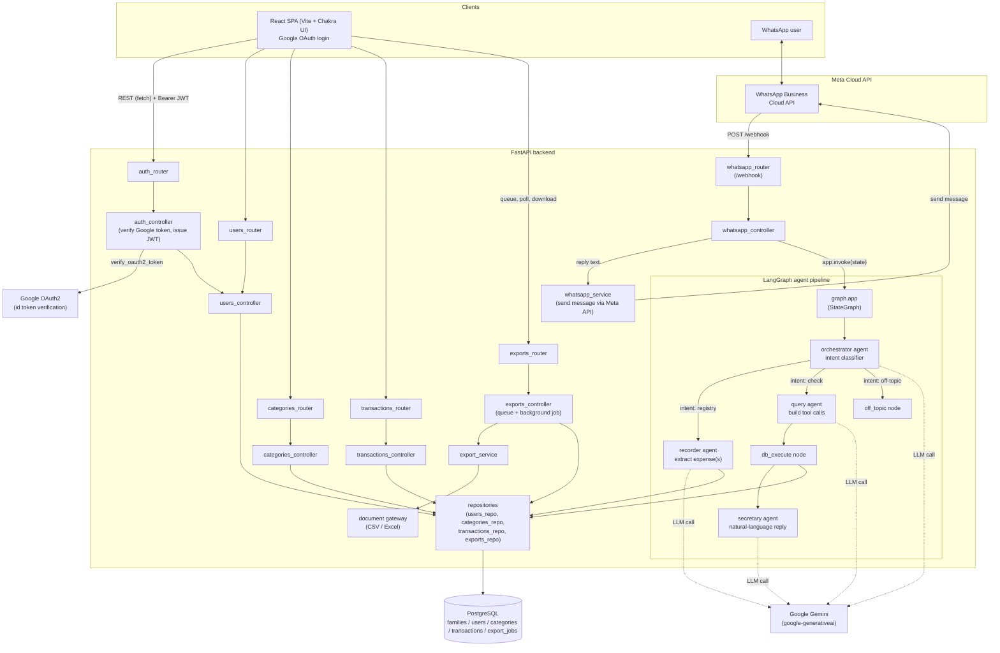
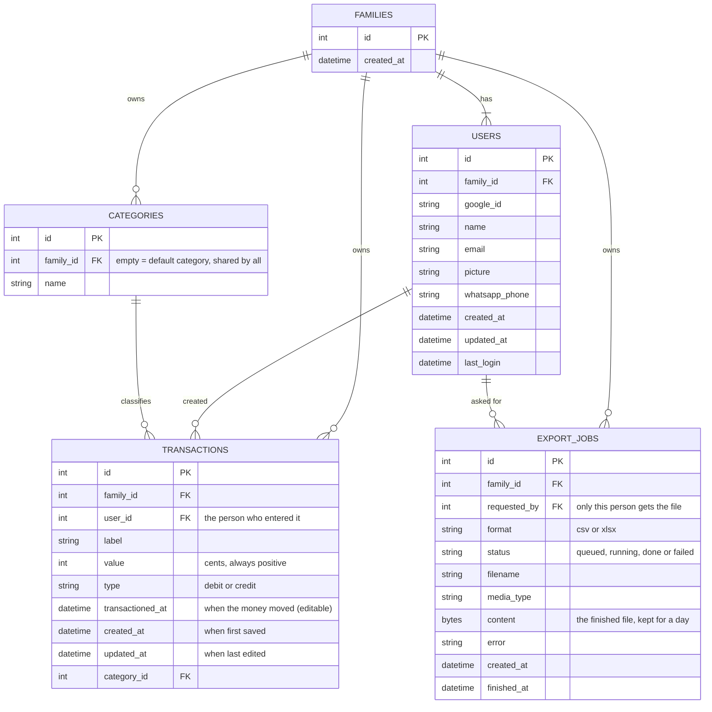
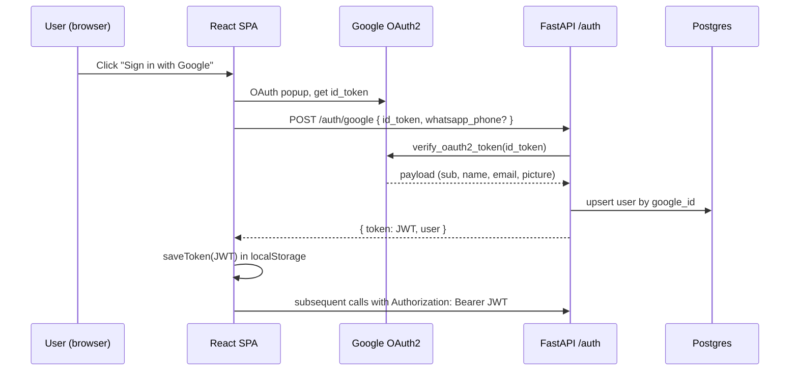
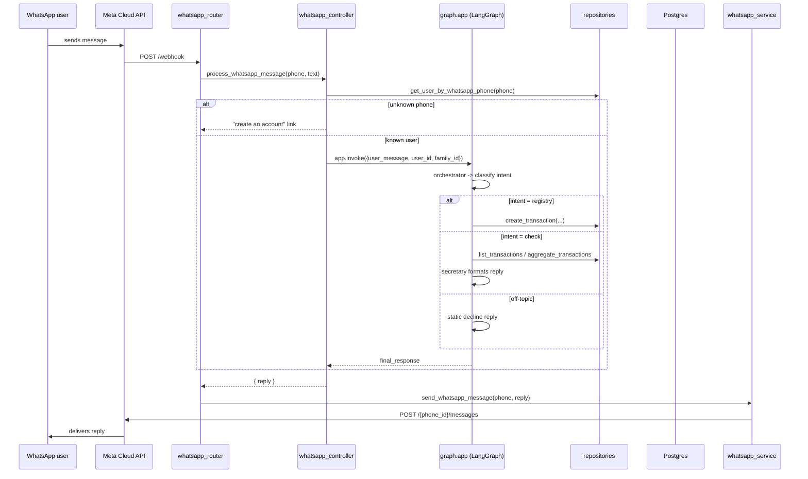

# Money Budget — System Design

## 1. Overview

Money Budget is a personal finance tracker with two front doors onto the same
data: a **React web dashboard** and a **WhatsApp chatbot**. Both are backed by
a single FastAPI service and a Postgres database. The WhatsApp side runs
messages through a small **LangGraph agent pipeline** that classifies intent,
extracts expenses from free text, or answers questions by querying the
database and summarizing the results in natural language.

## 2. High-level architecture

## 3. Components

### 3.1 Front-end (`front-end/`)
- React (Vite) SPA, `HashRouter`-based, Chakra UI for components/theming.
- `lib/auth.js` stores the JWT in `localStorage` and attaches it as a Bearer
  token to every API call (`lib/utils.js` / `api/endpoints.js`).
- Pages: `dashboard` (balance + charts), `report-expense` (manual entry),
  `transactions-display` (table of history with filters in a menu, 10-per-page
  paging for older entries, a side panel to add a transaction via
  `POST /transactions/create` and to edit one via `PUT /transactions/{id}`, and delete from a row menu), `investments`, `account`
  (a left menu with sections as nested routes: `/account` profile and
  `/account/data` import/export: the export queues a job (`POST /exports`), shows a
  toast, follows the job and downloads the file when it is done, with a second
  toast; the follow-up lives in `lib/exportJobs.js` (outside React) so it
  survives leaving the page; the import is not built yet and its page documents
  the expected file columns). Toasts are mounted once, in the layout. The logo in the header links home.
- `components/Chatbot.jsx` gives the same conversational flow as WhatsApp
  from inside the web app.

### 3.2 Backend (`back-end/`)
Layered FastAPI app: **router -> controller -> repository -> DB**.
- `routers/` — HTTP route declarations only.
- `controllers/` — request orchestration / business rules.
- `repositories/` — SQLAlchemy queries against the Postgres tables. Every
  function takes the database session as its first argument.
- `services/` — logic that is not a request or a query: `whatsapp_service.py`
  (outbound calls to the Meta Cloud API) and `export_service.py` (turns a user's
  transactions into a table of Data / Descrição / Categoria / Valor / Tipo and
  asks a document gateway for the file).
- `gateways/documents/` — the **document gateway**: the only place that knows
  file formats. The app hands it a plain `Table` and gets a `Document` (bytes,
  media type, extension) back. `CsvGateway` writes UTF-8 with a BOM and `;`
  between columns (opens correctly in Brazilian Excel); `XlsxGateway` (openpyxl)
  keeps real dates and numbers. `get_document_gateway("csv" | "xlsx")` picks one,
  so a new format is a new gateway and nothing else changes.
- `utils/formatting.py` — pure helpers for how values are shown: `1.234,56`,
  `DD/MM/YYYY`, Débito / Crédito, and `neutralize_formula`, which stops text a
  user typed (a description) from running as a formula when the file is opened
  in a spreadsheet (leading `'`). The apostrophe is a visible side effect: a
  description that really starts with `=`, `+`, `-` or `@` is exported with it, so
  the import has to remove one leading `'` from such cells.
- `db/connection.py` — SQLAlchemy engine/session (`DB_URL` is required and must
  be a PostgreSQL URL; the app refuses to start without it). Each request gets its own session from the
  `get_db` dependency, closed when the request ends. Code outside a request
  (the LangGraph nodes) opens a short-lived one with `session_scope()`.

### 3.3 Auth
- Frontend obtains a Google ID token (`@react-oauth/google`).
- `POST /auth/google` verifies it against Google, upserts the user, and
  returns an app-issued JWT (HS256, 7-day expiry). The signing key comes from
  `JWT_SECRET`; the API refuses to start without it unless `APP_ENV=development`.
- Every protected endpoint depends on `get_current_user_id` (FastAPI
  `HTTPBearer` + `decode_jwt`; the token only carries the user id). Endpoints
  that read or write budget data depend on `get_current_family_id`, which looks
  up the user's family and is the only scope they use (see "Families" in 3.5).
  A token whose user no longer exists answers `401`.
- In the web app, any `401` from the API (expired or invalid token) clears the
  stored token and sends the user to `#/login-google` (`api/endpoints.js`).
  A failed read is never treated as data; the dashboard and transactions pages
  show an error message when their data cannot be loaded.
- A user can also be matched by `whatsapp_phone`, which is how the chatbot
  resolves an inbound WhatsApp number to an account (a person); that person's
  family decides where the assistant saves and reads. The number is stored as
  digits only and is unique (a database constraint); claiming one that belongs
  to another account, from the login or `PATCH /user/me/phone`, answers `409`.

### 3.4 WhatsApp agent pipeline (`agents/`, `graph/`)
A LangGraph `StateGraph` (`graph/graph.py`) over `AssistantState`
(`graph/state.py`), driven per-message from `whatsapp_controller.py`:

| Node | Role |
|---|---|
| **orchestrator** | Classifies the message as `check`, `registry`, or `off-topic`. |
| **recorder** | On `registry`: extracts one or more expense items (amount, description, category, date) and writes `Transaction` rows (always `debit`; the item's date becomes `transactioned_at`, never in the future) via the repositories. |
| **query** | On `check`: turns the question into one or more structured tool calls (`list_transactions`, `summarize_transactions`) with filters (date range, category, search text, min/max amount, weekday). |
| **db_execute** | Executes the query agent's tool calls against the repositories, converting cents to reais. |
| **secretary** | Formats the DB results plus the original question into a natural-language (Portuguese) reply. |
| **off_topic** | Static decline reply for anything non-financial. |

Each agent node calls out to an LLM (Google Gemini via `google-generativeai`)
with a dedicated system prompt (`agents/<name>/prompt.py`) and typed
request/response schemas (`schemas/agents_schemas.py`).

### 3.5 Data model

**Families.** Data belongs to a family (the people who share one budget), not to a
person. A user is in exactly one family (`users.family_id`, not null; no membership
table). Every new user gets a family of their own on their first login, so for now
every family has one person; inviting people comes with TKT-43. `transactions`,
`categories` and `export_jobs` carry `family_id`, and every list, create, edit,
delete, export and chatbot action filters by the caller's family. A foreign id
answers `404`, the same as a missing one. `transactions.user_id` records who
entered a row (shown later in the UI, never used for permission). A category with no
`family_id` is a default one, visible to everyone; `GET /categories` now requires
login and returns the defaults plus the family's own. Export jobs read the family's
transactions, but only the person in `requested_by` can see or download the job, and a
family can have one export queued or running at a time. The chatbot state carries both
`user_id` (who spoke, saved on the transaction) and `family_id` (what it reads and writes).

**`transactions` columns**

| Column | Meaning |
|---|---|
| `value` | Amount in integer cents. Always positive (the API rejects 0, negatives and values over the 32-bit limit on edit); the direction is in `type`, never in the sign. Converted to reais (`/100`) at the API/agent boundary. |
| `type` | `debit` (money out, the default) or `credit` (money in). Not null. Spending totals (the summary at the top of the transactions page, `summed-by-category`) count debits only. |
| `transactioned_at` | When the money moved. The user can change it (the edit form picks a day and keeps the time of day). Defaults to the moment of creation. Never in the future for entries made in the web app or by the chatbot. This column used to be called `date`. |
| `created_at` | When the row was first saved. Set by the database, never changed. |
| `updated_at` | When the row was last edited through `PUT /transactions/{id}`. Empty until the first edit. |

`created_at` and `transactioned_at` are different on purpose: back-dating an
entry changes only `transactioned_at`. All timestamps are naive (no time zone)
and written by the server, so they follow the server clock.

**Schema changes** are Alembic revisions in `back-end/migrations/versions/`, applied by
`python -m db.upgrade` before the API starts (see 5). The history so far: `0001` the
first schema (category stored as text), `0002` category as a foreign key (names and
unknown values go to "Outros"), `0003` `type` (old rows become `debit`), `0004` `date`
renamed to `transactioned_at` with `created_at` back-filled from it (before the rename,
`date` was always the save time) and `updated_at` empty, `0005` the `export_jobs` table, `0006` a unique
`users.whatsapp_phone` (numbers are cleaned to digits first; when several users shared one, the
oldest account keeps it), `0007` families (one per existing user; rows move from `user_id` to
`family_id` (and `requested_by` on exports; transactions keep `user_id` as the author); transactions with no user, which nobody could read, are deleted).

**Transaction endpoints** (all require login and only see the caller's rows):
`POST /transactions/` (list), `POST /transactions/summed-by-category`,
`POST /transactions/create`, `PUT /transactions/{id}` (label, value, category,
and optionally `type` / `transactioned_at`; omitted fields keep their value) and
`DELETE /transactions/{id}`. A missing id, another family's id, or an unknown
category answers `404`, the same for missing and foreign ids so other users' ids
are not revealed. The two list endpoints take an optional `{organized_by: day|month|year, date}`:
the period is the full day, month or year of `date` (March 2026 is not March 2025), and
`organized_by` without a `date` answers `422`.

**Export jobs** (`export_jobs` table, `/exports`): `POST /exports {format}` records a
job as `queued`, answers `202` at once and builds the file in a FastAPI background
task (own session via `session_scope`; no extra service to run). The job goes
`queued -> running -> done | failed`. `GET /exports/{id}` shows the state and
`GET /exports/{id}/file` downloads it (`409` until it is done). The file is every
transaction of the caller's family, newest first, with no page limit. A family can have one
export queued or running at a time (`409` otherwise). Finished files are kept in
the table for a day: whenever anyone queues an export, every job older than a day
is deleted, and an expired job answers `404` even before it is deleted. A failed
job stores a generic message (the details go to the log); another person's job
answers `404`. The task runs inside the API process, so a job that is running when
the server restarts would stay `running`: a job queued or running for over five
minutes is marked failed the next time it is read or the user queues an export,
and the page gives up after two minutes. Times come from the database clock. A
separate worker would be the next step if exports ever get large.

## 4. Key request flows

### 4.1 Web login (Google OAuth)

### 4.2 WhatsApp message -> agent pipeline

## 5. Deployment / runtime notes
- Backend: `uvicorn api.app:app --reload`, FastAPI with CORS restricted to the
  `FRONT_URL` origin (the same address is used for the WhatsApp sign-up link).
- Frontend: Vite dev server (`npm run dev`), talks to the API via
  `VITE_API_URL`.
- Config: one `.env` at the repo root (see `.env.example`) feeds compose, the
  back-end (`find_dotenv` walks up to it) and Vite (`envDir: '..'`). Back-end
  settings (`FRONT_URL`, `GEMINI_MODEL`, `SQL_ECHO`) are read once in
  `back-end/config.py`.
- Database migrations: Alembic (`back-end/alembic.ini`, `back-end/migrations/`).
  `python -m db.upgrade` applies them and is safe to run any number of times. A database
  from before Alembic (no `alembic_version` table) is inspected to find which of the old
  hand-written changes it already has, that revision is recorded, and only the missing
  ones run; an empty database gets every revision. A change to a model in
  `schemas/tables.py` needs a new revision (`alembic revision --autogenerate`); the tests
  fail if the models and the migrations disagree, and exercise upgrade, downgrade and
  adopting a pre-Alembic database. Two processes starting at once are safe: a database
  lock makes the second wait for the first. Each run is one transaction in PostgreSQL, so
  a failing revision leaves the database as it was. Downgrades exist for development and
  lose data that the older schema cannot hold (the credit/debit `type`, `created_at`,
  and the `category_id` links). Seeding the default categories is a separate command,
  `python -m db.seed`, and a failed seed stops the start-up. Only the Docker Compose file
  runs these commands: any other way of starting the API (the Dockerfile's plain
  `uvicorn`) must run `python -m db.upgrade` first. PostgreSQL is required (SQLite cannot
  run these revisions).
- Tests: `pytest` runs inside the `api` container against a separate
  `<db>_test` Postgres database (transaction rolled back per test); see
  `back-end/tests/README.md`.
- Local dev: `docker compose up --build` (root `docker-compose.yml`) runs
  three services: `db` (Postgres 16, named volume), `api` (FastAPI with
  `--reload`; runs `db.upgrade` and `db.seed` before starting) and `web`
  (Vite dev server). Source is bind-mounted for hot reload. The compose
  `DB_URL` must use `postgresql+psycopg2://` (SQLAlchemy 2.1 defaults a bare
  `postgresql://` to psycopg v3, which is not installed).
- DB: PostgreSQL everywhere (local dev, tests, production). `DB_URL` is required; there
  is no SQLite fallback.
- External dependencies: Google OAuth2 (login), Google Gemini (agent LLM
  calls), Meta WhatsApp Cloud API (chat channel). Libraries: `openpyxl` (writes
  Excel files in the document gateway) and `alembic` (database migrations).

## 6. Testing
- **Scope:** back-end (`back-end/tests/`, `pytest`) and front-end
  (`front-end/src/**/*.test.*`, Vitest + React Testing Library on jsdom).
- **Database:** a real Postgres database named `<POSTGRES_DB>_test`, created
  automatically and separate from the dev one. Each test runs in a transaction
  that is rolled back; the app's sessions (`get_db`, `session_scope`) are bound
  to it, so commits become savepoints.
- **Layers covered:** HTTP endpoints through FastAPI's `TestClient`
  (router -> controller -> repository -> DB), the LangGraph database node, and
  the login secret loading.
- **External services:** Gemini calls are blocked by default and agents are
  stubbed per test; Google token verification is monkeypatched. Nothing in the
  suite reaches the network.
- **Front-end:** components and pages are tested like a user would use them;
  `fetch` is replaced per test, so no test reaches a real server. Google sign-in
  is stubbed.
- **CI:** `.github/workflows/tests.yml` runs both suites on every pull request
  and on pushes to `main` (the back-end against a Postgres service container;
  the front-end job also runs the linter and a production build).
  The checks are named "Back-end tests" and "Front-end tests"; a branch rule
  requiring them blocks merges when they fail.
- Run commands and conventions: `back-end/tests/README.md`.
