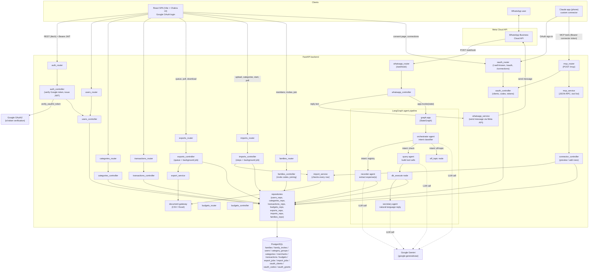
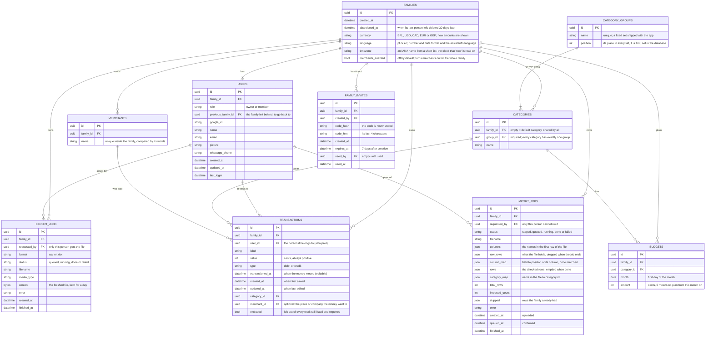
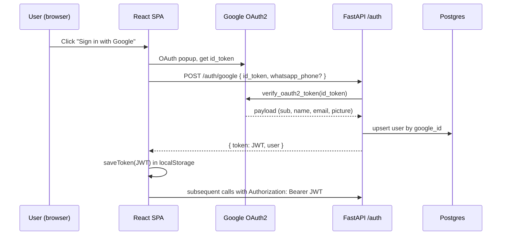
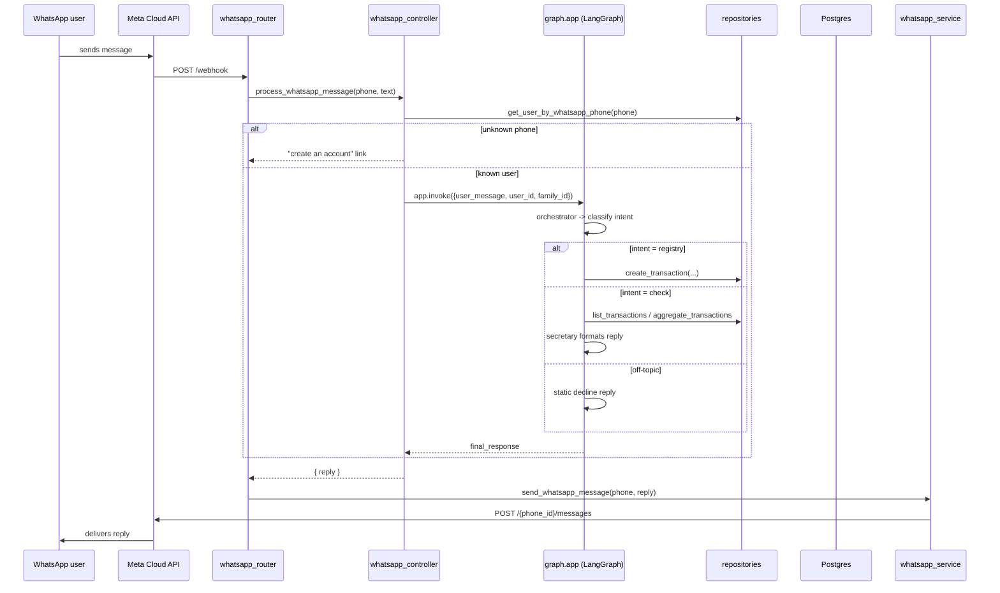
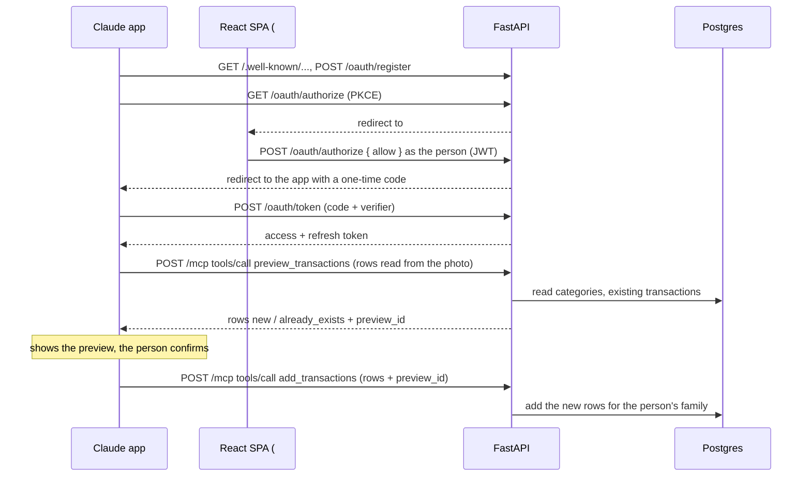

# Money Budget — System Design

## 1. Overview

Money Budget is a personal finance tracker with two front doors onto the same
data: a **React web dashboard** and a **WhatsApp chatbot**. Both are backed by
a single FastAPI service and a Postgres database. The WhatsApp side runs
messages through a small **LangGraph agent pipeline** that classifies intent,
extracts expenses from free text, or answers questions by querying the
database and summarizing the results in natural language.

## 2. High-level architecture

## 3. Components

### 3.1 Front-end (`front-end/`)
- React (Vite) SPA, `HashRouter`-based, Chakra UI for components/theming.
- Installable as a PWA: `public/manifest.json` (name, icons, standalone display) and `public/sw.js`, a small service worker registered
  from `lib/pwa.js` in the built app only. It keeps the app's own files (network first for the page, cache first for `/assets/*`) and never
  touches the API or non-GET requests, so data is always live; there is no offline data.
- `lib/auth.js` stores the JWT in `localStorage` and attaches it as a Bearer
  token to every API call (`lib/utils.js` / `api/endpoints.js`).
- Pages: `dashboard` (fixed panels for one month, chosen with a month switcher: what is left of the month's plan, from the budgets API; what came in and what went out in the month with the balance (entries are the credits, a salary or a refund, but not the other side of a transfer between accounts; exits are the spending below);
  spending day by day against the month before; the latest transactions; and the top categories. Only spending counts: credits are left out, and so are debits in the Receitas and Transferências groups (card-bill payments, moves between accounts), the same groups the budget ignores, so every panel agrees with the plan. Only the transactions of the chosen month and of the month before it (which the spending card compares with) are loaded, as a `start`/`end` range, and again whenever the month changes (never the whole history, which would grow with every month of use); the cards appear as soon as they and the categories arrive, without waiting for the person's name or the family (grey placeholders in the shape of the cards until then); changing month keeps the cards of the month on screen, dimmed, until the new month arrives, and a month already seen in the visit is shown from memory while it is asked for again; the plan is asked for again for each month, and if it cannot be loaded the other panels still show. The month is kept in the address (`/?month=2026-02`, no parameter for the current month; an invalid or future month means the current one), replacing the entry in the history, so reloading or sharing the page keeps it. The links of the panels carry the month in the address: `/budgets?month=2026-03` opens the plan of that month, and `/transactions?from=2026-03-01&to=2026-03-31&type=debit` opens the list already filtered to its days, debits only for the spending panels), `budgets` (the plan per category, repeated month to month until changed, and how it is going), `report-expense` (manual entry),
  `transactions-display` (table of history, with the picture of each row's person, filters in a menu (including one person), 10-per-page
  paging for older entries, a side panel to add a transaction via
  `POST /transactions/create` and to edit one via `PUT /transactions/{id}`, delete from a row menu, and a "Selecionar" mode that shows tick boxes on the rows (clicking a row ticks it instead of opening the editor; with "select all shown") to change many at once through `POST /transactions/bulk-update` (category, person, merchant, left out of the totals; what is left on "Não alterar" is untouched) or delete them through `POST /transactions/bulk-delete`; the table uses the wide layout on large screens and never scrolls sideways), `investments`, `account`
  (a left menu with sections as nested routes: `/account` profile (its WhatsApp number settings are hidden until the web app is built with `VITE_WHATSAPP_ENABLED=true`),
  `/account/duplicates` (its own entry in the account menu: pick a first and last day (three months back by default; optionally ignoring transactions left out of the totals, via `ignore_excluded`), see the groups of transactions of the same day, amount and type, choose the one to keep in each group (the first one saved by default, "manter todas" or "excluir todas"), side by side in a table, and delete the rest of all groups, or of one group with its own "Aplicar neste grupo" button, after a confirmation, through `POST /transactions/duplicates` and `POST /transactions/bulk-delete`),
  `/account/categories` the family's categories under their groups (every group is shown, even an empty one, with an
  "Adicionar" button that opens the side panel already set to that group; rename, change group and delete for its own
  ones; the default ones are marked "Padrão" and cannot be changed; the emoji grid is a keyboard-friendly radio group),
  `/account/merchants` (only while the family has merchants on: rename and delete, with the server's message when a
  merchant is still used; new ones are created by typing a name in a transaction),
  `/account/family` the family (people, invite codes for the owner, joining with a code, going back to the family left behind for 30 days) and
  `/account/data` import/export: the export queues a job (`POST /exports`), shows a
  toast, follows the job and downloads the file when it is done, with a second
  toast; the follow-up lives in `lib/exportJobs.js` (outside React) so it
  survives leaving the page. The same page documents the file columns and opens the **import dialog**
  (`components/ImportDialog.jsx`), a dialog in six steps: 1) choose the file, which is uploaded and read (nothing is
  checked yet); 2) **formats**: how the file writes dates (DD/MM/AAAA, MM/DD/AAAA, AAAA-MM-DD, or automatic) and amounts
  (`1.234,56`, `1,234.56` or automatic), and what the sign of the amount means (always positive with the type in a
  column, negative is debit, or negative is credit), with the first rows of the file to judge by; 3) **columns**: which
  column of the file is Data, Descrição, Categoria, Valor, Tipo, Pessoa and, with merchants on, Estabelecimento (those named like the fields come already chosen;
  Tipo is left out when the sign says the direction; the last two are optional; the first rows of the file can be folded away); 4) **check**: leaving step 3 sends the choices and checks every
  row the way steps 2 and 3 said, by itself; it shows "tudo certo" or lists all the problems with their row (nothing
  is imported, and the person can go back to change columns or formats); 5) for each category in the file the family does not
  have, pick an existing one or create it (name and group) without leaving the dialog, skipped when nothing is
  unknown; 6) for each name of the Pessoa column, see the member it was matched to by its name (and change it) or choose one
  when none matched, skipped when the file has no names; 7) confirm, with the number of transactions to import, how the dates were read and the list of those the
  family already has, which will be skipped. "Importar" queues the job and closes the dialog; `lib/importJobs.js`
  (outside React, like the export) polls it and announces how many rows were imported and skipped. Cancelling throws the checked file away). Toasts are mounted once, in the layout. The logo in the header links home.
- `components/Chatbot.jsx` gives the same conversational flow as WhatsApp
  from inside the web app.

### 3.2 Backend (`back-end/`)
Layered FastAPI app: **router -> controller -> repository -> DB**.
- `routers/` — HTTP route declarations only.
- `controllers/` — request orchestration / business rules.
- `repositories/` — SQLAlchemy queries against the Postgres tables. Every
  function takes the database session as its first argument.
- `services/` — logic that is not a request or a query: `whatsapp_service.py`
  (outbound calls to the Meta Cloud API), `export_service.py` (turns a user's
  transactions into a table of Data / Descrição / Categoria / Valor / Tipo / Pessoa / Fora dos totais (Sim or Não) and
  asks a document gateway for the file) and `import_service.py` (the reverse: checks every row of a table read
  from a file and collects all the problems, with the row number as the spreadsheet shows it).
- `gateways/documents/` — the **document gateway**: the only place that knows
  file formats. The app hands it a plain `Table` and gets a `Document` (bytes,
  media type, extension) back. `CsvGateway` writes UTF-8 with a BOM and `;`
  between columns (opens correctly in Brazilian Excel); `XlsxGateway` (openpyxl)
  keeps real dates and numbers. `get_document_gateway("csv" | "xlsx")` picks one,
  so a new format is a new gateway and nothing else changes. Each gateway also has a **reading side**,
  `read(bytes) -> Table`: CSV is UTF-8 with or without a BOM, separated by `;` or `,` (whichever the header uses
  more); Excel is read in read-only mode from the first sheet, keeping real dates and numbers. Reading enforces the
  limits (5 MB, 20,000 rows with something in them, and at most 1,000 empty rows on top of that, because a few KB of
  Excel can declare a million; only the first 100 columns) while it reads, so a huge file is never built, and raises
  `UnreadableDocument` with a message for the person for anything it cannot read (a damaged sheet included). Times and
  durations in Excel are read as text, and a number is read as Excel shows it (15 significant digits, so a cell that
  holds 0.30000000000000004 is 0.3); formulas are read as their last saved result, so an Excel file whose formulas
  were never calculated has empty cells.
- `utils/formatting.py` — pure helpers for how values are shown: `1.234,56`,
  `DD/MM/YYYY`, Débito / Crédito, and `neutralize_formula`, which stops text a
  user typed (a description) from running as a formula when the file is opened
  in a spreadsheet (leading `'`). The apostrophe is a visible side effect: a
  description that really starts with `=`, `+`, `-` or `@` is exported with it, so
  the import removes one leading `'` from such cells (`remove_formula_guard`). The reverse helpers sit next
  to it: `parse_amount` (both `1.234,56` and `1,234.56`, or one style strictly; at most two decimals), `parse_date` (day first,
  month first or year first) and `parse_type`.
- `db/connection.py` — SQLAlchemy engine/session (`DB_URL` is required and must
  be a PostgreSQL URL; the app refuses to start without it). Each request gets its own session from the
  `get_db` dependency, closed when the request ends. Code outside a request
  (the LangGraph nodes) opens a short-lived one with `session_scope()`.

### 3.3 Auth
- Frontend obtains a Google ID token (`@react-oauth/google`).
- `POST /auth/google` verifies it against Google, upserts the user, and
  returns an app-issued JWT (HS256, 7-day expiry). The signing key comes from
  `JWT_SECRET`; the API refuses to start without it unless `APP_ENV=development`.
- Every protected endpoint depends on `get_current_user_id` (FastAPI
  `HTTPBearer` + `decode_jwt`; the token only carries the user id, written as a UUID string). Endpoints
  that read or write budget data depend on `get_current_family_id`, which looks
  up the user's family and is the only scope they use (see "Families" in 3.5).
  A token whose user no longer exists answers `401`.
  Tokens issued before TKT-74 carry a counting number instead of a UUID: they are refused (`401`, "Invalid token"), so
  everyone logs in again once, after the update.
- In the web app, any `401` from the API (expired or invalid token) clears the
  stored token and sends the user to `#/login-google` (`api/endpoints.js`).
  A failed read is never treated as data; the dashboard and transactions pages
  show an error message when their data cannot be loaded.
- A user can also be matched by `whatsapp_phone`, which is how the chatbot
  resolves an inbound WhatsApp number to an account (a person); that person's
  family decides where the assistant saves and reads. The number is stored as
  digits only and is unique (a database constraint); claiming one that belongs
  to another account, from the login or `PATCH /user/me/phone`, answers `409`.

### 3.3.1 Claude connector sign-in (TKT-72)
A second, separate way to sign in, for AI apps (the Claude app on a phone) that add transactions through `POST /mcp`. It is
OAuth 2.1 with PKCE, in front of the existing Google login; it does not replace it and the two never open each other's door.
- The app discovers the server from `GET /.well-known/oauth-protected-resource` and `/.well-known/oauth-authorization-server`
  (the address in them is `PUBLIC_URL`, or the address of the request), registers itself with `POST /oauth/register`
  (dynamic client registration, public client: no secret; only `https` return addresses, or `http` for localhost; at most 5;
  apps nobody signed in with are forgotten after 30 days) and sends the person to `GET /oauth/authorize`.
- That checks the request (registered return address, `code_challenge_method=S256` mandatory) and redirects to the web app's
  `#/connect` page. An invalid request is shown as an error and **never redirected**: the return address is not trusted
  until it matches the registration. The page needs the normal Google login (an unauthenticated visitor is sent to the login
  and brought back), tells the person what the app may do and asks. The answer is `POST /oauth/authorize` with the person's
  normal JWT, which answers with where to send the browser: the app's return address with a one-time `code` (5 minutes,
  stored as a hash, spent when tried) or with `error=access_denied`.
- `POST /oauth/token` swaps the code (checking PKCE, the app and the return address) for an **access token** (1 hour) and a
  **refresh token** (30 days), random strings stored only as SHA-256 hashes in `oauth_grants`. Refreshing replaces both
  (the old refresh token stops working). `POST /oauth/revoke` (RFC 7009) forgets a token.
- A *grant* is one person's connection with one app. `GET /connections` lists the signed-in person's, and
  `DELETE /connections/{id}` removes one (a foreign id answers `404`); both need the normal JWT, which is how a person
  disconnects from Account -> "Assistentes de IA". Removing the row ends access at once.
- A connector token only opens `/mcp` and the normal JWT does not open `/mcp`; both lookups are by different means (a hash
  in the table versus a signed token), so one cannot be mistaken for the other.

### 3.3.2 The connector tools (`POST /mcp`)
A stateless Model Context Protocol server (JSON-RPC over HTTP, written directly instead of with the MCP SDK: three tools
need `initialize`, `ping`, `tools/list` and `tools/call` only, nothing is streamed or kept between calls, so it works on any
number of instances and scaled to zero). `GET`/`DELETE /mcp` answer `405`. Without a valid token the answer is `401` with a
`WWW-Authenticate` header pointing at the protected-resource page. It lives in its own routers and controller so a bug there
cannot break the rest of the API, and it is limited to 1 MB per request and 60 calls a minute per connection (counted in
memory, per instance: a brake against a runaway chat, not a quota).
Claude reads the photo or PDF; the server only receives rows and calls no LLM. Everything runs as the signed-in person in
their family: rows get that family and that `user_id`.
- `list_categories`: the family's categories (name and group). Read-only.
- `preview_transactions(rows)`: checks up to 200 rows `{date YYYY-MM-DD, description, amount_cents (positive integer),
  type debit|credit, category}` with the same rules as the spreadsheet import (a real date, not in the future by the family's
  clock, description up to 100 characters, positive amount up to the 32-bit limit, a known category found the way the import
  finds it, including English and unaccented names). Nothing is saved. It says per row whether it is `new` or
  `already_exists` (same day, description, amount, category and type, as in the import), lists every problem, and returns a
  `preview_id` only when all rows are valid. Read-only.
- `add_transactions(rows, preview_id)`: the **only tool that writes, and it can only add**: there is no tool to change,
  delete or read transactions. The `preview_id` is an HMAC (with the server secret) of the person and the exact normalised
  rows, so only rows that were previewed, by that person, can be added; changed rows are refused. Rows the family already has
  are skipped, so sending the same statement twice adds nothing twice. The family row is locked while checking and adding, and
  it is all or nothing.
- The tool descriptions tell the AI to show the preview and add only after the person confirms, and the Claude app asks the
  person to approve tool calls. The server itself cannot see that confirmation: `preview_id` proves the rows were previewed,
  not that the person said yes. Text inside a document is untrusted, so what limits a manipulated chat is that the tools are
  narrow: it can only add valid rows (at most 200 per call, 60 calls a minute), never read, change or delete anything.
- The consent page shows the address the person returns to, because anyone can register an app under any name; any address
  other than the Claude app's (`claude.ai`, `claude.com`) is shown with an "unverified app" warning.
- `preview_id` is `<expiry>.<HMAC>`: it expires after 15 minutes and uses a key derived from `JWT_SECRET`, not the login key.
  `preview_transactions` also warns about **possible duplicates** before anything is added: a `new` row on the same day with the same amount and type as a transaction the family already has gets `similar_existing` (up to 3: description and category), and one that matches an earlier row of the same call gets `same_as_rows_in_this_call` (row numbers); `possible_duplicates` counts them. Only a warning (`status` stays `new`, `add_transactions` still adds it if sent): the AI is told to ask the person and leave out what they do not want, then preview again. Same rule as the duplicate check on the transactions page.
  A person can add at most 1,000 transactions an hour (by any means), however many calls. The preview also tells whether a
  described transaction exists, which is the one thing it reveals about existing data.
- Responses carry `X-Frame-Options: DENY` / `frame-ancestors 'none'` (so the consent page cannot be framed) and `nosniff`;
  `/mcp` answers are `no-store`. `/oauth/*` bodies are limited to 16 KB and only `application/x-www-form-urlencoded` is read
  at the token and revoke addresses. An unexpected error in a tool answers a generic JSON-RPC error, never details.

### 3.4 WhatsApp agent pipeline (`agents/`, `graph/`)
A LangGraph `StateGraph` (`graph/graph.py`) over `AssistantState`
(`graph/state.py`), driven per-message from `whatsapp_controller.py`:

| Node | Role |
|---|---|
| **orchestrator** | Classifies the message as `check`, `registry`, or `off-topic`. |
| **recorder** | On `registry`: extracts one or more expense items (amount, description, category, date, and the merchant only while the family has merchants on) and writes `Transaction` rows (always `debit`; the item's date becomes `transactioned_at`, never in the future) via the repositories. |
| **query** | On `check`: turns the question into one or more structured tool calls (`list_transactions`, `summarize_transactions`) with filters (date range, category, search text, min/max amount, weekday, and merchant and a per-merchant total only while the family has merchants on). |
| **db_execute** | Executes the query agent's tool calls against the repositories, converting cents to reais. |
| **secretary** | Formats the DB results plus the original question into a natural-language reply, in the family's language and currency. |
| **off_topic** | Static decline reply for anything non-financial. |

Each agent node calls out to an LLM (Google Gemini via `google-generativeai`)
with a dedicated system prompt (`agents/<name>/prompt.py`) and typed
request/response schemas (`schemas/agents_schemas.py`).

### 3.5 Data model

**Identifiers (TKT-74).** Every table is keyed by a random UUID (v4, made by the application; Postgres `uuid`
type), and every link (`family_id`, `user_id`, `category_id`, ...) is a UUID too. Ids therefore cannot be guessed or
counted, and have no order: nothing may sort by id to mean "newest" (lists sort by date, name, `position` or
`created_at`, and a tie falls back to the id only to be stable between calls). The API writes them as text in JSON and
accepts them as text in paths, bodies and query strings; an id that is not a UUID answers `422`, and a well-formed one
nobody has answers `404`, the same as another family's. The chatbot state and the JWT (`user_id`, as text) carry them
as text too. The job tables keep ids inside JSON columns (`import_jobs.rows`, `category_map`) as text. Migration
`0019` converts a database in place, keeping every link; it deletes spreadsheet imports in progress (they are only
kept for a day) and can be undone (the downgrade hands out new counting numbers, not the old ones). Take a copy of the
database before running it: it locks the tables while it runs.

**Families.** Data belongs to a family (the people who share one budget), not to a
person. A user is in exactly one family (`users.family_id`, not null; no membership
table). Every new user gets a family of their own on their first login and is its
owner (`users.role`, `owner` or `member`); people who join with an invite are members. `transactions`,
`categories`, `export_jobs` and `import_jobs` carry `family_id`, and every list, create, edit,
delete, export and chatbot action filters by the caller's family. A foreign id
answers `404`, the same as a missing one. `transactions.user_id` is the person a
row belongs to (who paid): the person adding it unless another member of the same family is chosen, shown as a picture on
each row, and never used for permission. Choosing someone outside the family answers `404`. Known limit: rows entered in a family
by a person who later returns to the family they left keep that person, who is no longer a member there; they show no
picture and keep that owner until someone picks another member in the edit form. A category with no
`family_id` is a default one, visible to everyone; `GET /categories` now requires
login and returns the defaults plus the family's own, each with its group (`group_id`, `group_name`).
`GET /categories/groups` lists the groups. Export jobs read the family's
transactions, but only the person in `requested_by` can see or download the job, and a
family can have one export queued or running at a time. The chatbot state carries both
`user_id` (who spoke, saved on the transaction) and `family_id` (what it reads and writes).

**Budgets** (`/budgets`, TKT-61, all require login and only see the caller's family). A family plans how much to
spend in each spending category, and a plan **stays in force until it is changed**: the amount set in a month is
the plan of every later month that has no amount of its own. So `budgets` (family, category, first day of a month,
amount in cents; unique per family, category and month) mostly holds the months where the amount *changes* (a later
row that repeats the one before it can exist, and is harmless); the plan of a month is the latest row up to it. A row of 0 means "nothing from this month on" and is what remembers that a plan
was stopped. Asking for the amount that already applies from an earlier month keeps no row of its own (and removes the
month's own row if it had one), so the month goes back to following the earlier plan. Categories of the groups
"Receitas" and "Transferências" have no budget: money coming in or moving between accounts is not spending.
`GET /budgets?month=YYYY-MM` answers the month by group and category: `budgeted` (null when nothing applies),
`since` (the month that set the amount: the month itself, or an earlier one when it is repeated), `spent` (debits of
the month in that category, credits never count; the month runs from its first moment to the first moment of the
next), and totals. `totals.spent` only counts categories that have a budget, so it compares with `totals.budgeted`;
`totals.remaining` is the difference (negative when over) and `totals.unbudgeted_spent` is what was spent in the
other spending categories (debits with no category, and debits in an income or transfer category, are in neither
number, so the two do not add up to every debit of the month). `PUT /budgets {category_id, month, amount}` sets the
amount from that month on (0 stops the plan from then on) and answers with the month as `GET` shows it; another
family's category, an income or transfer one and an unknown id all answer `404`, and a bad month (only the years 2000
to 2099 are offered, and the page's buttons stop there) or an amount that is negative or over the 32-bit limit `422`.
`PUT` takes the same family lock as the category changes, so two requests (two members, two tabs) cannot both create
the same row, and a category being deleted at that moment is seen as gone. The Orçamentos page (`/budgets`, in the top
menu) shows one month with buttons to move between months, totals with a bar, every group (all start open; each can
be closed) with its categories, and a field per category (the family's currency symbol beside it) that saves
when it is left or Enter is pressed. Amounts are meant to be round: the field takes whole units ("1500") and shows
them without decimals ("R$ 1.500"); decimals are only there when typed, with "," or "." ("1500,5" is R$ 1.500,50), and
an amount with cents is shown with two decimals. Groups and categories come in order of priority, from what a household
has to pay first (housing, bills, food, transport) to what it can cut first (shopping, leisure, gifts), not A-Z: the
groups follow their `position` (migration 0023 sets it from the list in `api/utils/budget_order.py`), and the server
sorts the categories of a group by that list, the family's own after the default ones, A-Z; "Repetido de <month>" says where an amount comes from, and a bar turns orange
from 80% of the plan and red when it is exceeded. Budgets follow their categories: deleting a category deletes its
budgets, and so does moving it to an income or transfer group (nothing hidden is kept); joining another family with the
data brings the transactions and categories but not the budgets (a plan belongs to the family that made it: the
budgets of the family being left are deleted, the family joined keeps its own); a family that is deleted after 30
days takes its budgets with it. Not built yet: budgets for a group or for income, rollover of unused
money, a yearly view and alerts.

**Currency, language and timezone** (family settings, TKT-25 and TKT-65). `families.currency` (`BRL` default, also `USD`, `CAD`, `EUR`,
`GBP`), `families.language` (`pt` default, also `en`) and `families.timezone` (`America/Sao_Paulo` default, also a
short list of zones: the Americas and Europe the currencies come from, and `UTC`) belong to the family, so everyone in
it sees the same and a person who joins another family gets that family's. `GET /families/me` returns all three;
`PATCH /families/me/settings {currency?, language?, timezone?}` changes them (any member, not only the owner; a field left out keeps its value; a value that is
not offered answers `422`). The currency is only how an amount is shown: amounts stay integer cents and nothing is
converted between currencies. The language decides the number separators and the order of day and month, and the
language the WhatsApp assistant answers in. The page loads the settings once in the layout (`lib/locale.js`; until they
arrive, or if they cannot be loaded, it shows reais and Portuguese) and the Preferências page under Conta changes them.
The assistant reads them from the family on every message: the recorder and the secretary are told the language (and
the secretary the currency), and what the code itself says (the "Registrado!" confirmation, amounts, dates, weekday
names, the refusal of off-topic messages) comes from `graph/messages.py` and `api/utils/formatting.py`. Not covered
yet: the text of the screens stays in Portuguese (TKT-57), and the export files keep their documented Brazilian
format.

*The timezone and "now"* (TKT-65). A transaction's `transactioned_at` is the wall-clock time of the family, stored
without a timezone, and every cut by day or month (budgets, dashboard, filters, exports) reads those digits as they
are. So "now" is never read from the clock of the server or of the device: the back-end asks `api/utils/clock.py`
(`family_now(timezone)`, `family_today(timezone)`) and the page asks `familyNow()` in `lib/locale.js`, both on the
family's timezone. This is what puts a purchase made at 22:30 on 31 March in March wherever the server runs. It is used
when a transaction is created without a date (web and chatbot), to refuse future dates in the chatbot and in imports,
and in the "today" the recorder and query agents are told. Dates a person types or a file brings are kept as written.
Moving a family to another timezone does not rewrite the transactions it already has.

**Inviting and joining** (`/families`, all require login). `GET /families/me` shows the
family's people (`members`), the caller's role and the caller's own id (`me`, so pages can pre-select them). Only the owner can `POST /families/invites`
(answers the code, `201`), `GET /families/invites` (the active codes) and
`DELETE /families/invites/{id}`; a member gets `403`. A code is 16 characters from an
alphabet without look-alikes, shown only when created: the table keeps a SHA-256 hash and the last four
characters (to tell codes apart in a list). It works once and expires after 7 days (database clock); an owner can
have 3 active codes (counted under a lock on the family, so two requests cannot both take the last place). `POST /families/join {code, bring_data}` moves the caller into the code's family
as a member; `bring_data` is required, so the choice is always explicit. A code that is wrong, used, expired
or cancelled all answer the same `404`. Rules: someone who shares a family with other people cannot join
another (`409`; leaving or handing over ownership comes later); a code for one's own family is refused (`409`) and
not used up. Joining is one database transaction under row locks (the family being left, and the code), so
the code cannot be used twice at once and a failure changes nothing. With `bring_data` true the
caller's transactions move to the new family (`user_id` still the author) and each of their categories is
merged into the new family's category with the same name (ignoring case and accents; its transactions are
re-pointed, the duplicate deleted), otherwise it comes along as it is; default categories are never touched.
With it false the old data stays in the old family, out of sight.
Either way the old family is left empty: it is marked abandoned (`families.abandoned_at`) and its unused
codes are deleted, because they could otherwise let a stranger into the data left there. Joining also takes
its locks in a fixed order (the person, both families by id, the code), so one person cannot join twice at
once, and nobody can join a family while its only person is walking out of it (a family nobody is in cannot
be joined).

**Going back and cleanup.** A person who joined with `bring_data` false has `users.previous_family_id`, and
`POST /families/rollback` takes them back to that family as its owner for 30 days after it was abandoned
(`404` after that, when they brought their data, or when there is nothing to go back to; `409` for an owner of
a family with other people). What they entered in the family they leave stays in it, and if that leaves it
empty it is abandoned too. `GET /families/me` shows `previous_family.available_until` while going back is
possible, and the Família page offers the button. After 30 days an abandoned family is deleted for good with
everything it holds (transactions, its own categories, export files, codes). The deletion has no scheduler: it
runs, like the export files cleanup, whenever someone joins a family. It only touches families nobody is in,
whatever their date says, and a person whose previous family is deleted simply has nothing to go back to.

**`transactions` columns**

| Column | Meaning |
|---|---|
| `value` | Amount in integer cents. Always positive (the API rejects 0, negatives and values over the 32-bit limit on edit); the direction is in `type`, never in the sign. Converted to reais (`/100`) at the API/agent boundary. |
| `user_id` | The family member the transaction belongs to (who paid). Set to the caller on create unless another member of the same family is sent; changeable through `PUT`. Imports and the WhatsApp assistant use the person importing / whose number wrote. Not a permission. |
| `type` | `debit` (money out, the default) or `credit` (money in). Not null. Spending totals (the summary at the top of the transactions page, `summed-by-category`) count debits only. |
| `excluded` | True when the person left the transaction out of the totals (TKT-87). Not null, false unless set. It stays in lists and exports, but no sum counts it: `summed-by-category` (and so the budgets' spending), the assistant's totals (`aggregate_transactions`, through `_apply_filters(..., counted_only=True)`), and, in the web app, the dashboard panels and the merchant totals (`countsAsSpending`, `countsAsIncoming`). Sent on `POST /transactions/create` and `PUT /transactions/{id}` (`excluded`; left out, a create takes the category's default and an edit keeps it). The default is `true` for a category named "Transferência" or "Pagamento de fatura do cartão" in the group "Transferências" (`api/utils/totals.py`, mirrored by `front-end/src/lib/totals.js`; "Ajustes de saldo" is a correction and counts); migration `0020` marked the existing ones. The older rule by group (the budget and the dashboard ignore Receitas and Transferências for spending) stays as it was. |
| `transactioned_at` | When the money moved. The user can change it (the edit form picks a day and keeps the time of day). Defaults to the moment of creation on the family's clock. Never in the future for entries made in the web app or by the chatbot. This column used to be called `date`. |
| `created_at` | When the row was first saved. Set by the database, never changed. |
| `updated_at` | When the row was last edited through `PUT /transactions/{id}`. Empty until the first edit. |

**`category_groups` columns**

| Column | Meaning |
|---|---|
| `id` | Primary key. Used by `categories.group_id`. It does **not** decide the order. |
| `name` | The heading shown to people ("Moradia", "Alimentação"...). Unique, not null. The same set for every family. |
| `position` | **The order of the groups.** Integer, not null, 1 is first. Every list of groups sorts by it (then by `id` to break a tie): the category list, the Categorias page and the Orçamentos page. Added by migration `0015` (existing groups kept their old order); a new database gets it from `DEFAULT_GROUPS` in `db/seed.py`. The full order is in "Order of the category groups" below. |

**`budgets` columns**

| Column | Meaning |
|---|---|
| `family_id` | Whose plan it is. A plan belongs to the family that made it and is never brought to another family. |
| `category_id` | The spending category the plan is for (never one of the income or transfer groups). |
| `month` | The first day of the month the amount starts to apply from. With `family_id` and `category_id` it is unique. |
| `amount` | Planned cents from that month on, until a later month changes it. `0` means "no plan from this month on". |

`created_at` and `transactioned_at` are different on purpose: back-dating an
entry changes only `transactioned_at`. All timestamps are naive (no time zone).
`transactioned_at` is the wall-clock time of the family, read on its timezone (see "The timezone and now" under
Family settings); the bookkeeping ones (`created_at`, `updated_at`...) are written by the database or the server and
follow the server clock.

**Schema changes** are Alembic revisions in `back-end/migrations/versions/`, applied by
`python -m db.upgrade` before the API starts (see 5). The history so far: `0001` the
first schema (category stored as text), `0002` category as a foreign key (names and
unknown values go to "Outros"), `0003` `type` (old rows become `debit`), `0004` `date`
renamed to `transactioned_at` with `created_at` back-filled from it (before the rename,
`date` was always the save time) and `updated_at` empty, `0005` the `export_jobs` table, `0006` a unique
`users.whatsapp_phone` (numbers are cleaned to digits first; when several users shared one, the
oldest account keeps it), `0007` families (one per existing user; rows move from `user_id` to
`family_id` (and `requested_by` on exports; transactions keep `user_id` as the author); transactions with no user, which nobody could read, are deleted; a transaction that pointed at another
person's category becomes uncategorised), `0008` `users.role` (everyone is an owner) and `family_invites`, `0009` `families.abandoned_at` (families that
are already empty start their 30 days) and `users.previous_family_id`, `0010` `category_groups` and `categories.group_id`
(default categories are grouped by name; every other category, such as a family's own, goes to "Outros"; the
new default categories are created by the seed command), `0011` an emoji in front of the name of each default
category (data only: no column; a family's own categories are untouched), `0012` the default categories of Monarch
Money (data only: the 12 groups and 39 defaults are replaced by 14 groups and 51 defaults; each old default is renamed
into the closest new one, and when several become one their transactions move to the one kept; a family's own
categories keep their names and move to the group that replaces theirs; the downgrade restores the old groups and
names, but merged categories stay merged), `0013` `families.currency` and `families.language` (existing families keep reais and Portuguese), `0014` the `budgets` table, `0015` `category_groups.position`, `0016` the `import_jobs` table, `0017` `families.timezone` (existing families get `America/Sao_Paulo`; the dates already stored are left as they are), `0018` the `merchants` table, `transactions.merchant_id` (empty for every existing transaction) and `families.merchants_enabled` (off for every existing family), `0019` UUID identifiers for every table (every link is kept; imports in progress are dropped; old login tokens stop working), `0020` `transactions.excluded` (left out of the totals; false for every transaction except those in the "Transferência" and "Pagamento de fatura do cartão" categories, which are marked), `0021` the `oauth_clients`, `oauth_codes` and `oauth_grants` tables for the Claude connector (new tables only), `0022` an index on `transactions (family_id, transactioned_at)` for the common read "a family's transactions in a period" (no data changes).

**Category groups.** Categories are listed under a group (the same ones Monarch Money has, in Portuguese:
Receitas, Presentes e Doações, Auto e Transporte, Moradia, Contas e Serviços, Alimentação, Compras, Viagem e Estilo de
Vida, Filhos, Educação, Saúde e Bem-estar, Finanças, Outros, Transferências). The groups are a fixed set, the same for every family, in the order of `category_groups.position` (1 first, kept in the database; the Categorias and Orçamentos pages and every API list use it, and `db.seed` gives a group it creates the place it has in `DEFAULT_GROUPS`, never moving one that exists):
nothing in the API creates, renames or deletes one. Each category has exactly one (`categories.group_id`, not
null, a foreign key), and a category saved without one goes to "Outros". The 51 default
categories mirror Monarch's (for example "Supermercado", "Restaurantes e Bares", "Luz e gás", "Salário", "Transferência";
"Sem categoria" in "Outros" is where the assistant puts an expense it cannot place) and live in `db/seed.py`
(`DEFAULT_GROUPS`) for new databases; migration `0012` keeps its own copy for existing ones, and a test fails when the
two differ, so changing a default category later needs a new migration. The Categorias page lists the categories under their groups; filters and totals per group are not built yet. The assistant's own
category list (`schemas/agents_schemas.py`) is separate and does not use groups: it is the default categories
except income and transfers (a test keeps it in step with the seed).

**Order of the category groups.** The order is data, not an accident of how the rows were created: each group has an
integer `category_groups.position` (not null, 1 is first, added by migration `0015`, which gave the groups already in a
database the positions of their old id order). Everything that lists groups sorts by `position` (then `id`, to break a
tie): `GET /categories/groups`, the groups of `GET /budgets`, and so the Categorias and Orçamentos pages. A new
database gets the order below from `DEFAULT_GROUPS` in `db/seed.py`, which gives a group it creates the place it has
in that list and never moves one that already exists; nothing in the API changes the order yet.

| position | group |
|---|---|
| 1 | Receitas |
| 2 | Presentes e Doações |
| 3 | Auto e Transporte |
| 4 | Moradia |
| 5 | Contas e Serviços |
| 6 | Alimentação |
| 7 | Compras |
| 8 | Viagem e Estilo de Vida |
| 9 | Filhos |
| 10 | Educação |
| 11 | Saúde e Bem-estar |
| 12 | Finanças |
| 13 | Outros |
| 14 | Transferências |

(The Orçamentos page leaves out Receitas and Transferências, which have no budget, and keeps the rest in this order.)

**Merchants** (`/merchants`, TKT-58, all require login and only see the caller's family). A merchant is the place or
company the money went to (Uber, iFood). It is an optional setting: `families.merchants_enabled` is off by default and
any member turns it on or off with `PATCH /families/me/settings {merchants_enabled}` (`GET /families/me` returns it, and
the front-end keeps it in `lib/locale.js` next to the other settings). Off hides merchants everywhere (the form field,
the list, the filter, the totals, the Estabelecimentos page, and the WhatsApp assistant stops asking for or offering
them) but deletes nothing: turning them on again brings everything back. `merchants` has `family_id` and `name`;
`transactions.merchant_id` is optional, so a transaction without one stays valid and existing data is untouched
(migration `0018`). `GET /merchants` lists the family's with how many transactions use each, `POST /merchants {name}`
adds one (`201`), `PATCH /merchants/{id} {name}` renames and `DELETE /merchants/{id}` removes. As with categories, names
are trimmed, need words and at most 100 characters (`422`), cannot repeat inside the family, ignoring case and emoji
(`api/utils/category_names.py`, `409`), a missing or another family's id answers `404`, and deleting one that
transactions use is refused (`409`, the message says how many). A transaction names its merchant with `merchant` (a
name) on `POST /transactions/create` and `PUT /transactions/{id}`: an existing merchant with the same words is reused,
otherwise a new one is created; on `PUT` leaving it out keeps the merchant and `""` takes it off; naming one while
merchants are off answers `409`. The list endpoints return `merchant_id`; the transactions page loads the merchant
names from `/merchants` only while the setting is on, shows the name under the description, filters by merchant. Joining another family with the data brings its merchants and
merges those with the same words into the new family's; a family that is deleted after 30 days takes its merchants
with it. Not built: merchant logos, merging merchants, default categories per merchant, guessing the merchant from the
description, a merchant column in the export.

**Managing categories** (`/categories`, all require login). A family manages only its own categories; the default
ones (no `family_id`, `is_default` true in the list) are shown but cannot be changed. `POST /categories {name,
group_id}` adds one (`201`; without a group it goes to "Outros"), `PATCH /categories/{id} {name?, group_id?}` renames
it and/or moves it to another group (a field left out keeps its value), and `DELETE /categories/{id}` removes it.
Names are trimmed, cannot be empty or longer than 100 characters (`422`), and cannot repeat inside the family or
clash with a default category, ignoring case and surrounding spaces (`409`; the comparison is done in Python, so it
covers accented letters whatever the database locale). A group that does not exist answers `422`. Deleting a category
that transactions still use is refused (`409`, the message says how many; a transaction that takes the category at
the very moment it is deleted gets the same answer, never a `500`); there is no merge flow. Editing or deleting a
default category, another family's category or an id that does not exist all answer the same `404`. The checks run
while the family row is locked, so two requests cannot both take the same name. Every message is in Portuguese,
ready to show in the page. The lists that offer categories (the new-transaction form, the filters, the import
page) fetch them whenever they open, so a new category appears at once, sorted A-Z.

**Emoji in category names.** A category's emoji is the start of its name ("🛒 Supermercado"), not a separate
column. The default categories ship with one (`DEFAULT_EMOJIS` in `db/seed.py`, a test makes sure every default has
one; migration `0011` renames the existing ones, with its own frozen copy of the list). The add/edit panel offers a
grid of about 80 emojis, or none, and also accepts one typed into the name box; the page splits a stored name back
into its emoji and its words when editing. Because the emoji is part of the name, everything that compares or sorts
names looks at the words only (`api/utils/category_names.py` on the server, `lib/categoryName.js` in the page, which
split a name by the same rule: the start of a name that is made of symbols, skin tones, joiners and variation
selectors is the emoji). The duplicate check treats "Plantas" and "🌱 Plantas" as the same name, and also ignores
invisible characters (zero-width spaces and joiners), runs of spaces, full-width letters and an accent written as
a letter plus a combining mark; accents themselves still tell names apart. Merging categories when someone joins a
family compares by the words too. A name with nothing but an emoji or invisible characters is refused as empty, the WhatsApp assistant still finds "Supermercado" when the stored name is "🛒 Supermercado", and lists stay
A-Z by the words whatever the emoji. Anything that matches category names typed by a person (such as the planned
spreadsheet import) must compare the words only as well.

**Transaction endpoints** (all require login and only see the caller's rows):
`POST /transactions/` (list), `POST /transactions/summed-by-category`,
`POST /transactions/create` (optional `user_id`, a member of the family, default the caller), `PUT /transactions/{id}` (label, value, category,
and optionally `type` / `transactioned_at` / `user_id`, the person it belongs to; omitted fields keep their value) and
`DELETE /transactions/{id}`. `POST /transactions/bulk-update {ids, category_id?, user_id?, merchant?, excluded?}` changes the same fields on up to 500 transactions (at least one field; `merchant: ""` takes it off) and `POST /transactions/bulk-delete {ids}` deletes them; both are all or nothing: if any id is missing or another family's, or the category or person is not the family's, the answer is `404` and nothing changes. `POST /transactions/duplicates {start_date, end_date}` (both days included) answers the groups of two or more of the family's transactions with the same day, amount and type, each group oldest-saved first; labels and categories may differ, so it only suggests and the person decides (deleting goes through bulk-delete). A missing id, another family's id, or an unknown
category answers `404`, the same for missing and foreign ids so other users' ids
are not revealed. The two list endpoints take an optional `{organized_by: day|month|year, date}`:
the period is the full day, month or year of `date` (March 2026 is not March 2025), and
`organized_by` without a `date` answers `422`. Instead they take a range `{start, end}` (`start` included, `end` excluded, either may be
left out; written as the family's wall-clock time, a time zone is dropped): `start` not before `end`, or a range together with
`organized_by`, answers `422`. The dashboard uses the range.

**Export jobs** (`export_jobs` table, `/exports`): `POST /exports {format}` records a
job as `queued`, answers `202` at once and builds the file in a FastAPI background
task (own session via `session_scope`; no extra service to run). The job goes
`queued -> running -> done | failed`. `GET /exports/{id}` shows the state and
`GET /exports/{id}/file` downloads it (`409` until it is done). The file is every
transaction of the caller's family, newest first, with no page limit. A family can have one
export queued or running at a time (`409` otherwise). Finished files are kept in
the table for a day: whenever anyone queues an export, every job older than a day
is deleted, and an expired job answers `404` even before it is deleted. A failed
job stores a generic message (the details go to the log); another person's job
answers `404`. The task runs inside the API process, so a job that is running when
the server restarts would stay `running`: a job queued or running for over five
minutes is marked failed the next time it is read or the user queues an export,
and the page gives up after two minutes. Times come from the database clock. A
separate worker would be the next step if exports ever get large.

**Connector sign-in tables** (TKT-72, migration `0021`; see 3.3.1). `oauth_clients` (`id` is the client id, `name`,
`redirect_uris` JSON, `created_at`) are the registered apps; `oauth_codes` (`code_hash` unique, `client_id`, `user_id`,
`redirect_uri`, `code_challenge`, `expires_at`) are the one-time codes; `oauth_grants` (`client_id`, `user_id`,
`access_hash` and `refresh_hash` unique with their expiry, `created_at`, `last_used_at`) are the connections. Only hashes
of codes and tokens are stored. They hold no budget data, and expired codes and grants are deleted when new ones are made.

**Import jobs** (`import_jobs` table, `/imports`): importing is a conversation in steps, so the file waits on the
server between them. The job goes `staged -> queued -> running -> done | failed`.
1. `POST /imports` (multipart upload, needs `python-multipart`; one declared as larger than 5 MB is refused with `413`
   before its body is read, even before the login is checked) reads the file through the document gateway (`.xlsx`
   or `.csv`; unreadable files are a `422` with a message: wrong type, over 5 MB or 20,000 rows, empty, not UTF-8) and
   stores it as it is (`columns`, `raw_rows`, status `staged`). The answer has the column names, a suggested matching
   (the column named like each field, ignoring case and accents), a suggested sign convention and the first rows.
   Uploading again throws away the person's previous staged job.
2. `PUT /imports/{id}/columns {mapping, date_order, amount_style, sign}` says which column holds each field and how the
   file writes things, then checks **every** row before anything is kept. `mapping` is the position of each of Data,
   Descrição, Categoria, Valor, Tipo, Pessoa, Estabelecimento and Fora dos totais (only Tipo, Pessoa, Estabelecimento and Fora dos totais may be null; a column may serve more than one field). Fora dos totais is Sim or Não (anything else is a problem of that row); empty means the category's default (a transfer or a card payment is left out).
   Estabelecimento is only used while the family has merchants on: each name is compared with the family's merchants
   (the rule of `same_name`: case, spaces and emoji) and reused when one matches, otherwise a new merchant is created, all
   together with the import (so a failed import creates none); more than 100 characters or no letters at all is a problem of
   that row, and with merchants off the column is ignored. Pessoa is
   the name of a member of the family. A name that is exactly one member's (case and accents ignored) is matched by
   itself, an empty cell means the person importing, and the check lists every name of the column in `people`
   (`{name, rows, user_id}`; `user_id` is the member it was matched to, or null when there is none or when two members
   share the name; `unknown_people` is the null ones; `members` lists the family). The dialog shows all of them,
   the matched ones already chosen and marked, and `PUT /imports/{id}/people {mapping: {name in file: user id}}`
   records which member each stands for, changing the matched ones too when the person says so (a name that is not in the
   file, or a person outside the family, answers `422`; the choice is kept on the job's rows)
   and `POST /imports/{id}/start` answers `409` while one is left, as it does for categories. The export writes the
   same column. One file column may be chosen for more than one field (for example one column read as both the description and the category). `date_order` is
   `auto`, `day_first` (15/03/2026), `month_first` (03/15/2026) or `iso` (2026-10-13); separators `/ - .` are accepted,
   and a real Excel date is accepted in any case. `auto` reads the file: a number above 12 in the first place proves
   day first, in the second place month first, and if no date proves it, it is day first, the order of the file the app
   exports and of the page that describes it, whatever the family's language; `auto` also accepts year-first dates, while a chosen format is strict. `amount_style` is `auto`,
   `br` (`1.234,56`) or `us` (`1,234.56`); `auto` takes the last mark as the decimal mark, decimals are at most two, so
   three digits after a mark are a group (`1,234` and `1.234` are 1234), and `R$`/`$` are accepted. `sign` is
   `type_column` (the amount must not be negative and Tipo, empty meaning Débito, says the direction), `negative_debit`
   or `negative_credit` (the sign says the direction, the amount is stored positive, and a Tipo column may not be
   chosen). A zero amount is registered, not refused (as a debit, since it has no direction). Description up to 100 characters (the column's size), the date not in the future. If any row is
   wrong the answer is `422` with the problems (row and message, at most 200 shown plus the total) and **nothing is
   kept**; the job stays as it was so the person can choose differently. On success the checked rows are stored with
   the matching and the answer says how the dates, amounts and sign were read. A category that does not exist is **not**
   an error here.
3. `GET /imports/{id}` shows the job. Once checked it also says which categories of the file the family does not have
   yet (worked out on every read, so a category created meanwhile, from the dialog or from the Categorias page, settles
   by itself), how many rows would be imported and which would be skipped.
   `PUT /imports/{id}/categories {mapping: {name in file: category id}}` records that an unknown name stands for one
   of the family's categories (defaults or its own; a foreign or missing id is `422`). Names are compared by their
   words, as everywhere else, and the family's own category wins over a default one with the same name. A name of a
   default category in another language, or without accents, is found by itself too (`api/utils/category_aliases.py`: the
   English names of the Monarch Money categories and everyday words such as "Groceries" or "Mercado"; a word that could
   mean two categories, like "Transporte", is left out, so the person is asked); a name a category really has always wins
   over such an alias, and an alias only points at a default category that exists. The check also
   lists `new_categories`: every category of the file the family has no category of that name for, with the one chosen
   (`category_id`, null while none), and `file_categories`: **every** category name of the file, in file order, with the
   category it stands for now and `match` (`chosen` by the person, `name` the family has it, `alias` found by another name,
   null still to choose). The dialog always shows all of `file_categories`, matched ones already selected and labelled, so
   the person reviews the matching and can change any of it; what the person chose wins over what was matched by itself.
   Only names with no category (`unknown_categories`) block the start. Matching the columns again keeps
   the choices: if the checked rows come out the same (same columns and formats) nothing at all is touched, and if they
   change the choices about names still in the file (and who the person chose for a name of the Pessoa column) are kept.
   Both calls answer `409` before the columns are matched.
4. `POST /imports/{id}/start` answers `202` and queues the job (`409` while a category is still unsettled, while
   the family has another import queued or running, or if the job already started). The FastAPI background task
   saves the transactions in **one database transaction together with marking the job done**, so it is all or
   nothing. Rows the family already has (same day, description, amount, category and type) are **skipped, not
   errors**, and kept in the job (`skipped`) so they can be listed; two identical rows inside the same file are both
   imported. Imported rows belong to the family and `user_id` is the person who uploaded. If a chosen category was
   deleted in between, the job fails and nothing is saved. `DELETE /imports/{id}` gives up a staged job.

Like exports: one import at a time per family (stuck jobs are cleared first, then the family row is locked and nothing
commits until the job is queued, because a commit gives the lock up; so two members pressing Import together cannot
both pass), a job is deleted whenever anyone uploads once a day has passed since it was confirmed (since it was
uploaded, if it never was) and answers `404` from then on, a job queued for
over five minutes is marked failed the next time it is read or started, a failed job shows a generic message (details
in the log), and a foreign family's or another person's job answers `404`. The file and the rows are dropped from the job when it
finishes.

## 4. Key request flows

### 4.1 Web login (Google OAuth)

### 4.2 WhatsApp message -> agent pipeline

### 4.3 Adding transactions from the Claude app (TKT-72)

## 5. Deployment / runtime notes
- Backend: `uvicorn api.app:app --reload`, FastAPI with CORS restricted to the
  `FRONT_URL` origin (the same address is used for the WhatsApp sign-up link).
- Frontend: Vite dev server (`npm run dev`), talks to the API via
  `VITE_API_URL`.
- Config: one `.env` at the repo root (see `.env.example`) feeds compose, the
  back-end (`find_dotenv` walks up to it) and Vite (`envDir: '..'`). Back-end
  settings (`FRONT_URL`, `PUBLIC_URL`, `GEMINI_MODEL`, `SQL_ECHO`, `STATIC_DIR`, `DB_POOL_SIZE`, `DB_MAX_OVERFLOW`) are read once in
  `back-end/config.py`.
- Database migrations: Alembic (`back-end/alembic.ini`, `back-end/migrations/`).
  `python -m db.upgrade` applies them and is safe to run any number of times. A database
  from before Alembic (no `alembic_version` table) is inspected to find which of the old
  hand-written changes it already has, that revision is recorded, and only the missing
  ones run; an empty database gets every revision. A change to a model in
  `schemas/tables.py` needs a new revision (`alembic revision --autogenerate`); the tests
  fail if the models and the migrations disagree, and exercise upgrade, downgrade and
  adopting a pre-Alembic database. Two processes starting at once are safe: a database
  lock makes the second wait for the first. Each run is one transaction in PostgreSQL, so
  a failing revision leaves the database as it was. Downgrades exist for development and
  lose data that the older schema cannot hold (the credit/debit `type`, `created_at`,
  and the `category_id` links). Seeding the default categories is a separate command,
  `python -m db.seed` (it creates the groups and default categories that are missing, so it is safe to run twice), and a failed seed stops the start-up. Only the Docker Compose file
  runs these commands: any other way of starting the API (the Dockerfile's plain
  `uvicorn`) must run `python -m db.upgrade` first. PostgreSQL is required (SQLite cannot
  run these revisions).
- Tests: `pytest` runs inside the `api` container against a separate
  `<db>_test` Postgres database (transaction rolled back per test); see
  `back-end/tests/README.md`.
- Local dev: `docker compose up --build` (root `docker-compose.yml`) runs
  three services: `db` (Postgres 16, named volume), `api` (FastAPI with
  `--reload`; runs `db.upgrade` and `db.seed` before starting) and `web`
  (Vite dev server). Source is bind-mounted for hot reload. The compose
  `DB_URL` must use `postgresql+psycopg2://` (SQLAlchemy 2.1 defaults a bare
  `postgresql://` to psycopg v3, which is not installed).
- **Production (Google Cloud, TKT-68; guide in `docs/DEPLOY.md`).** One Cloud Run service (`money-budget`) runs the
  image built from the root `Dockerfile`: the API plus the built web app, which the API serves from `/` on the same
  address (`STATIC_DIR`; the app is hash-routed, so the only page address is `/`; API addresses always win over files),
  so there is no cross-origin traffic and `FRONT_URL` is that address. The generated `/docs`, `/redoc` and `/openapi.json` pages are off while the web app is served (they stay on in development). `POST /webhook/` answers `503` until `WHATSAPP_TOKEN` and `WHATSAPP_PHONE_ID` are set, because it has no signature check yet (TKT-27) and the address is public. A route the web app calls without a trailing slash must be registered with and without it, because the file server mounted at `/` takes over from the automatic redirect. The data is a database
  (`money_budget`, its own user that owns only it) on the Cloud SQL instance the team already has, reached through
  Cloud Run's built-in Cloud SQL connection; the password (`DB_PASSWORD`) and `JWT_SECRET` come from Secret Manager,
  never from the repository or the image. The pool is small (`DB_POOL_SIZE`, `DB_MAX_OVERFLOW`, `pool_pre_ping`) and the
  service is capped at 2 instances, so it cannot starve the other database users. CPU stays allocated
  (`--no-cpu-throttling`) because imports and exports run as FastAPI background tasks after the response is sent.
  Migrations are a Cloud Run Job (`money-budget-migrate`, `python -m db.upgrade`) that runs to the end before the new
  version is deployed; a failed migration stops the deploy. Seeding stays a manual command.
  `.github/workflows/deploy.yml` runs on every push to `main`: the tests and lint workflows first (reused through
  `workflow_call`), then build and push the image to Artifact Registry, run the migration job and deploy the service.
  GitHub proves who it is to Google with Workload Identity Federation (restricted to this repository and the `main`
  branch), so there is no key file anywhere. Cloud Run keeps old revisions, which is how a release is rolled back.
- DB: PostgreSQL everywhere (local dev, tests, production). `DB_URL` is required; there
  is no SQLite fallback.
- External dependencies: Google OAuth2 (login), Google Gemini (agent LLM
  calls), Meta WhatsApp Cloud API (chat channel). Libraries: `openpyxl` (writes
  and reads Excel files in the document gateway), `defusedxml` (makes openpyxl safe against crafted XML in uploaded
  files), `python-multipart` (file uploads for the import) and `alembic`
  (database migrations).

## 6. Testing
- **Scope:** back-end (`back-end/tests/`, `pytest`) and front-end
  (`front-end/src/**/*.test.*`, Vitest + React Testing Library on jsdom).
- **Database:** a real Postgres database named `<POSTGRES_DB>_test`, created
  automatically and separate from the dev one. Each test runs in a transaction
  that is rolled back; the app's sessions (`get_db`, `session_scope`) are bound
  to it, so commits become savepoints.
- **Layers covered:** HTTP endpoints through FastAPI's `TestClient`
  (router -> controller -> repository -> DB), the LangGraph database node, and
  the login secret loading.
- **External services:** Gemini calls are blocked by default and agents are
  stubbed per test; Google token verification is monkeypatched. Nothing in the
  suite reaches the network.
- **Front-end:** components and pages are tested like a user would use them;
  `fetch` is replaced per test, so no test reaches a real server. Google sign-in
  is stubbed.
- **CI:** `.github/workflows/tests.yml` runs both suites on every pull request
  and, through `deploy.yml`, on every push to `main` (the back-end against a Postgres service container;
  the front-end job also runs the linter and a production build).
  The checks are named "Back-end tests" and "Front-end tests"; a branch rule
  requiring them blocks merges when they fail.
- Run commands and conventions: `back-end/tests/README.md`.
